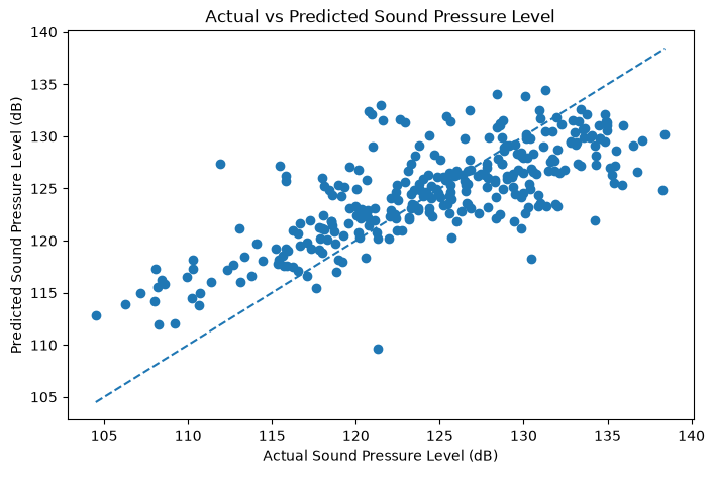
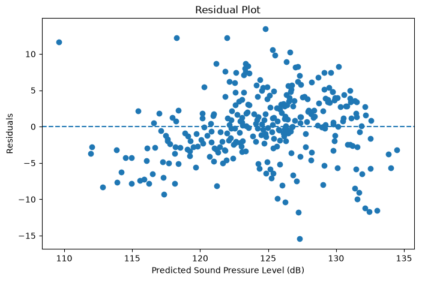

# Machine Learning-Based Prediction of Airfoil Self-Noise

Predicting the aerodynamic sound pressure level (in decibels) generated by airfoils using physical and aerodynamic parameters with Linear Regression on the NASA Airfoil Self-Noise dataset (UCI ML Repository).

---

## Team Members & Assigned Lead Roles

| Entry No. | Student Name | Email Address | Contact No. | Assigned Lead Role | GitHub Handle |
| :--- | :--- | :--- | :--- | :--- | :--- |
| 2026EEB1317 | Akshaj Mishra | 2026EEB1317@iitrpr.ac.in | 9958976665 | PPT Lead | [@Akshaj-Mishra-123](https://github.com/Akshaj-Mishra-123) |
| 2026AIB1019 | Arghya Mehta | 2026AIB1019@iitrpr.ac.in | 9667749037 | Execution Lead | [@ArghyaM-codes](https://github.com/ArghyaM-codes) |
| 2026MCB1529 | Himanshu Prajapati | 2026MCB1529@iitrpr.ac.in | 7851837461 | Documentation Lead | [@2026mcb1529-creator](https://github.com/2026mcb1529-creator) |
| 2026AIB1085 | Swarnum Thappa | 2026AIB1085@iitrpr.ac.in | 8082826450 | Video Lead | [@swarnum-ai](https://github.com/swarnum-ai) |

*All four members actively contributed code, data preprocessing analysis, model testing, and documentation.*
---

## Project Dataset Overview

* **Dataset**: NASA Airfoil Self-Noise Dataset
* **Source**: UCI Machine Learning Repository
* **Total Observations**: 1,503 rows
* **Target Variable**: Sound pressure level (in dB)
* **Input Features (5)**:
  1. Frequency (Hz)
  2. Angle of attack (degrees)
  3. Chord length (meters)
  4. Free-stream velocity (m/s)
  5. Suction side displacement thickness (meters)

---

## Project Structure

```text
Airfoil-self-noise-prediction/
├── dataset/
│   └── airfoil_self_noise.dat
├── docs/
│   └── Team_Presentation_Slides.pdf
├── notebooks/
│   ├── 01_eda_akshaj.ipynb
│   └── airfoil_analysis.ipynb
├── results/
│   └── plots/
│       ├── actual_vs_predicted.png
│       └── residual_plot.png
├── src/
│   └── utils.py
├── .gitignore
├── README.md
└── requirements.txt
```
Below are the evaluation plots generated by the model pipeline:

### Actual vs. Predicted Sound Pressure Level


### Residual Plot

* **Presentation Slides (PDF):** [View Slides](docs/Team_Presentation_Slides.pdf)
* **Video Demonstration:** [Watch Video (≤ 5 mins)](#) *(Link to be updated)*
* **Himanshu:** Gemini for assistance in repository architecture, modular documentation, utility helper coding, and rubric compliance checks.
* **Arghya:** ChatGPT for guidance in Python ML implementation, data preprocessing, and model debugging.
* **Akshaj:** ChatGPT for guidance in exploratory data analysis code generation, plotting, and slide content structuring.
* **Swarnum:** ChatGPT / Gemini for video script outline and demonstration walkthrough planning.

---

## Testing and Model Evaluation

### 1. Install Dependencies

Make sure Python is installed. Install the required dependencies using:

```bash
pip install -r requirements.txt
```

### 2. Run Automated Tests

The project includes unit tests for the reusable model evaluation and prediction visualization utilities.

From the root directory of the project, execute:

```bash
python -m unittest discover -s tests -v
```

The test suite verifies:

- Mean Absolute Error (MAE)
- Mean Squared Error (MSE)
- Root Mean Squared Error (RMSE)
- R² Score
- Correct return of all evaluation metrics
- Successful execution of the prediction plotting function

### 3. Model Evaluation

The reusable evaluation function is available in `src/utils.py`.

It can be imported and used as follows:

```python
from src.utils import evaluate_model

metrics = evaluate_model(y_test, y_pred)

for metric, value in metrics.items():
    print(f"{metric}: {value:.4f}")
```

### 4. Test Results

All automated unit tests should pass successfully before accepting changes to the evaluation utilities.

The tests can be executed independently without training the machine learning model again.
